# Zenith Product API

## 1. Introduction

The Zenith Product API is a backend application built using Node.js, Express.js, and MongoDB. It provides REST API endpoints for managing product information in an e-commerce application.

The API allows clients to create new products, retrieve product information, update existing products, and delete products from the database.

In addition to the basic CRUD operations, the API supports filtering products by category and price, sorting products by price, and retrieving products using pagination.

This project demonstrates how a backend application handles HTTP requests, communicates with a MongoDB database, and returns appropriate responses to clients.

## 2. Aim of the Project

The main objectives of this project are to:

- Build a REST API using Node.js and Express.js.
- Connect the Express application to MongoDB Atlas using Mongoose.
- Create a Product schema and model.
- Implement CRUD operations for managing product records.
- Implement dynamic filtering based on category and price.
- Add ascending and descending price sorting.
- Implement pagination using page and limit query parameters.
- Handle errors and return appropriate HTTP status codes.
- Test API endpoints and verify responses using Postman.

## 3. Technologies and Tools Used

| Technology / Tool | Purpose |
|---|---|
| Node.js | JavaScript runtime used to execute the backend application. |
| Express.js | Used to create the server and define API routes. |
| MongoDB Atlas | Cloud database used to store product information. |
| Mongoose | Used to define the Product schema and interact with MongoDB. |
| Postman | Used to send and test API requests. |
| dotenv | Used to load environment variables from the `.env` file. |
| VS Code | Code editor used for developing the project. |
| Git and GitHub | Used for version control and maintaining the project repository. |

## 4. Project Structure

The project is organized into separate folders to keep the database connection, data model, and API routes independent.

```text
zenith-product-api/
│
├── index.js
│
├── config/
│   └── connection.js
│
├── models/
│   └── Product.js
│
├── routes/
│   └── productRoutes.js
│
├── screenshots/
│
├── .env
├── .gitignore
├── package.json
├── package-lock.json
└── REFLECTION.md
```

The main responsibilities are:

- `index.js` – Entry point of the application. It configures Express, middleware, API routes, and starts the server.
- `config/connection.js` – Handles the connection to MongoDB Atlas.
- `models/Product.js` – Defines the Product schema and creates the Mongoose model.
- `routes/productRoutes.js` – Contains the API endpoints for product operations.
- `.env` – Stores environment variables such as the MongoDB connection string and server port.
- `.gitignore` – Prevents sensitive and unnecessary files from being included in Git commits.

## 5. Product Schema

The Product model defines the structure of product documents stored in MongoDB.

The schema contains the following fields:

| Field | Data Type | Description |
|---|---|---|
| name | String | Name of the product (required). |
| description | String | Description of the product (required). |
| price | Number | Product price (required and must be greater than 0). |
| category | String | Category to which the product belongs (required). |
| inStock | Boolean | Indicates whether the product is available. Defaults to `true`. |
| tags | Array of Strings | Stores tags associated with the product. |
| createdAt | Date | Records when the product was created. Defaults to the current date and time. |

Mongoose schema validation is used to ensure that required fields are provided and that the product price is greater than zero.

## 6. API Endpoints

All product-related routes use the following base URL:

`http://localhost:3000/api/products`

### CRUD Operations

| HTTP Method | Endpoint | Purpose |
|---|---|---|
| POST | `/api/products` | Create a new product. |
| GET | `/api/products` | Retrieve all products. |
| GET | `/api/products/:id` | Retrieve a product using its ID. |
| PUT | `/api/products/:id` | Update an existing product. |
| DELETE | `/api/products/:id` | Delete a product using its ID. |

### Filtering, Sorting, and Pagination

The GET `/api/products` endpoint also supports optional query parameters.

| Query Parameter | Example | Purpose |
|---|---|---|
| category | `category=Electronics` | Filters products by category. |
| minPrice | `minPrice=50` | Retrieves products priced at or above the specified amount. |
| maxPrice | `maxPrice=100` | Retrieves products priced at or below the specified amount. |
| sortBy | `sortBy=price_asc` | Sorts products from lowest to highest price. |
| sortBy | `sortBy=price_desc` | Sorts products from highest to lowest price. |
| page | `page=2` | Specifies the page number. |
| limit | `limit=5` | Specifies the maximum number of products returned per page. |

Multiple query parameters can be combined in a single request.

For example:

`GET /api/products?category=Electronics&minPrice=20&maxPrice=100&sortBy=price_asc&page=1&limit=2`

This retrieves matching Electronics products within the specified price range, sorts them in ascending price order, and returns the requested page.

## 7. HTTP Status Codes Used

The API uses HTTP status codes to communicate the outcome of requests.

| Status Code | Status | When It Is Used |
|---|---|---|
| 200 | OK | When a GET, PUT, or DELETE request is successful. |
| 201 | Created | When a new product is successfully created using POST. |
| 400 | Bad Request | When invalid product data or another request-related error occurs. |
| 404 | Not Found | When the requested product ID does not exist in the database. |

These status codes help clients understand whether a request was successful or whether an error occurred.

## 8. Sample Test Data

To test the product retrieval, filtering, sorting, and pagination functionalities, I created five sample products in MongoDB using the POST `/api/products` endpoint.

| Product Name | Price ($) | Category |
|---|---:|---|
| Wireless Mouse | 25.99 | Electronics |
| Coffee Maker | 79.99 | Home Appliances |
| Running Shoes | 59.99 | Sports |
| Smart Watch | 149.99 | Electronics |
| Blender | 45.50 | Home Appliances |

These sample records provide different categories and price ranges, allowing me to test individual query parameters as well as combined filtering, sorting, and pagination.

## 9. API Testing and Results

The API endpoints were tested using Postman to verify that the product operations, filtering, sorting, pagination, and error handling worked as expected.

The following table summarizes the tests performed and their results.

| Feature | Test Performed | Expected Result | Actual Result |
|---|---|---|---|
| Create Product | POST `/api/products` | 201 Created | Successful |
| Retrieve All Products | GET `/api/products` | 200 OK with a list of products | Successful |
| Retrieve Empty List | GET `/api/products` when no products exist | 200 OK with an empty array | Successful |
| Retrieve Product by ID | GET `/api/products/:id` | 200 OK with the matching product | Successful |
| Update Product | PUT `/api/products/:id` | 200 OK with the updated product | Successful |
| Delete Product | DELETE `/api/products/:id` | 200 OK with a success message | Successful |
| Category Filtering | `category=Electronics` | Returns products belonging to the Electronics category | Successful |
| Minimum Price Filtering | `minPrice=50` | Returns products priced at $50 or above | Successful |
| Maximum Price Filtering | `maxPrice=60` | Returns products priced at $60 or below | Successful |
| Ascending Price Sorting | `sortBy=price_asc` | Returns products from lowest to highest price | Successful |
| Descending Price Sorting | `sortBy=price_desc` | Returns products from highest to lowest price | Successful |
| Pagination | `page=1&limit=2` | Returns a maximum of two products | Successful |
| Combined Query | Multiple query parameters | Returns matching filtered, sorted, and paginated results | Successful |
| Product Not Found | GET request with a non-existing product ID | 404 Not Found | Successful |
| Invalid Product Data | POST request with an invalid price | 400 Bad Request | Successful |

## 10. Screenshot Evidence

The following screenshots provide evidence of the server setup, database connectivity, API implementation, and endpoint testing.

### 1. Server and Database Connection Verification

**1a. MongoDB connected and Express server running in terminal**

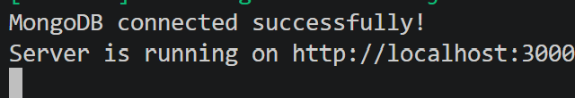

**1b. Express server responding successfully in browser**

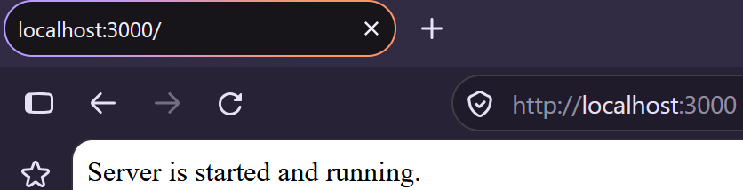

### 2. Create a Product – POST `/api/products`

**2a. Successful POST response in Postman**

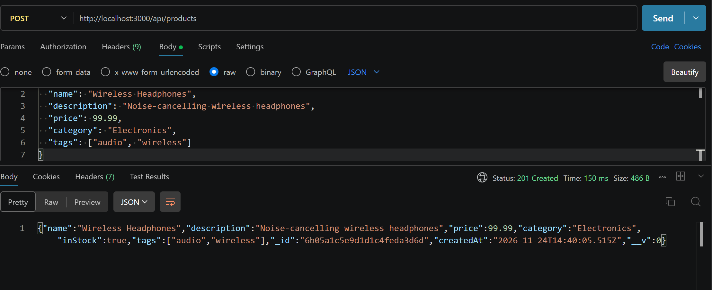

**2b. Product successfully saved in MongoDB**

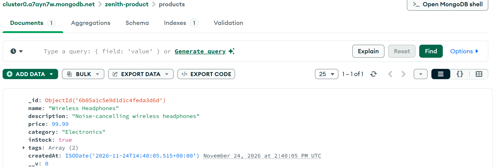

### 3. Retrieve a Product by ID – GET `/api/products/:id`

**3a. Successful GET response in Postman**

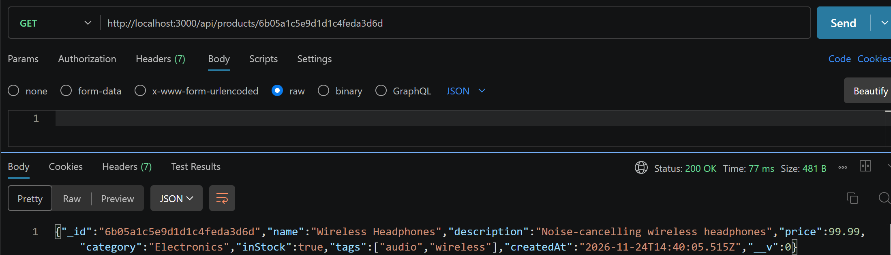

### 4. Update a Product – PUT `/api/products/:id`

**4a. Successful PUT response in Postman**

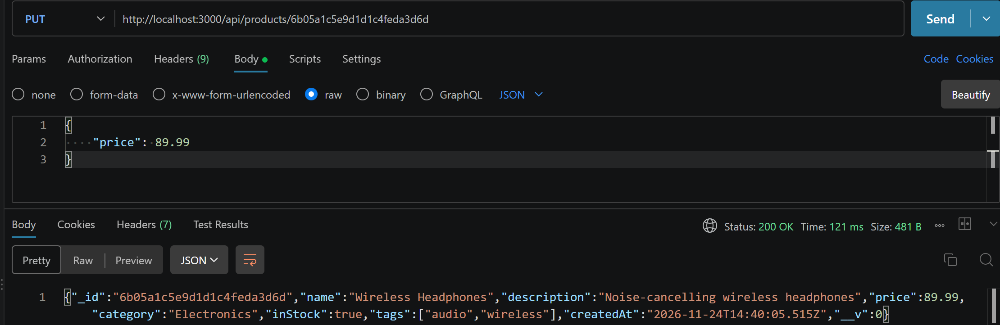

### 5. Delete a Product – DELETE `/api/products/:id`

**5a. Successful DELETE response in Postman**

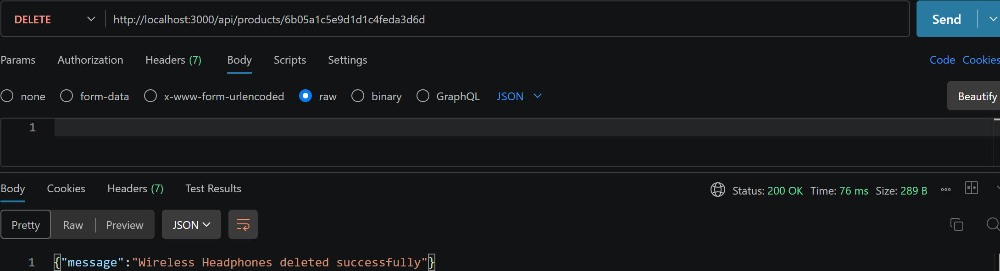

### 6. Retrieve All Products – GET `/api/products`

**6a. Successful GET response with an empty product list**

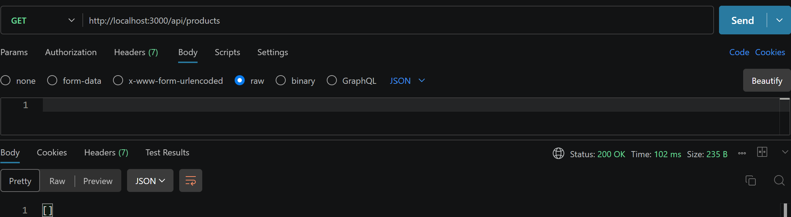

**6b. Successful GET response displaying all products**

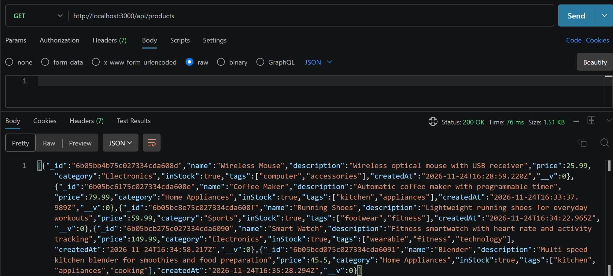

### 7. Product Filtering, Sorting, and Pagination

**7a. Filter products by category**

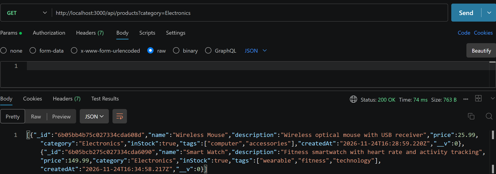

**7b. Filter products by minimum price**

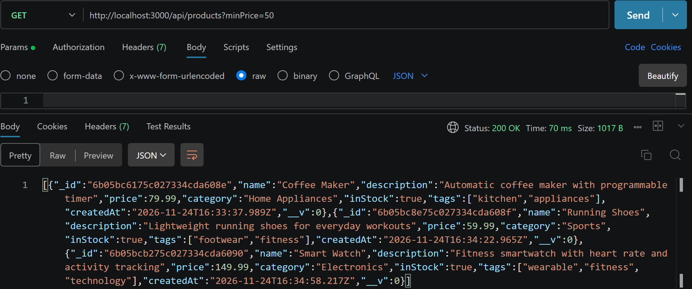

**7c. Filter products by maximum price**

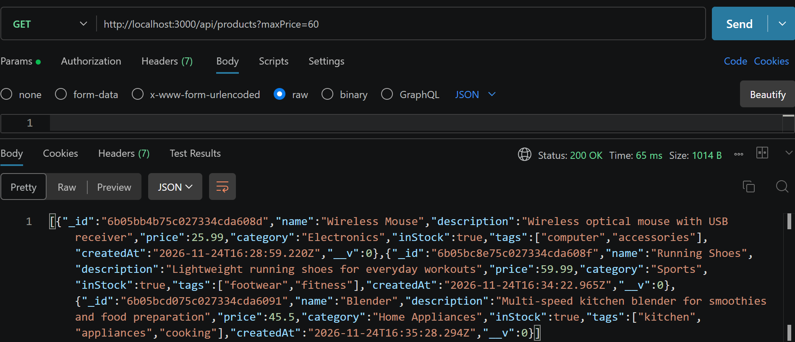

**7d. Sort products by price in ascending order**

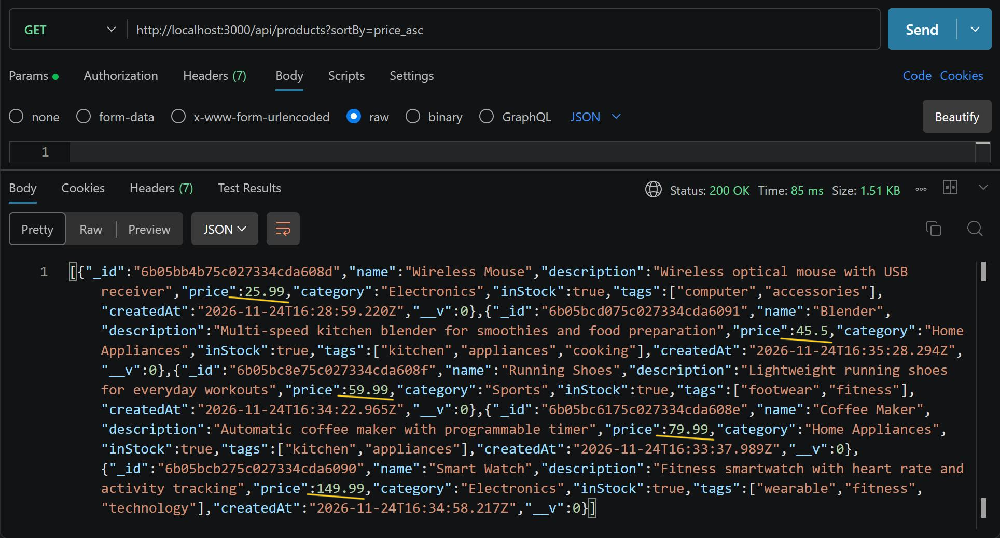

**7e. Sort products by price in descending order**

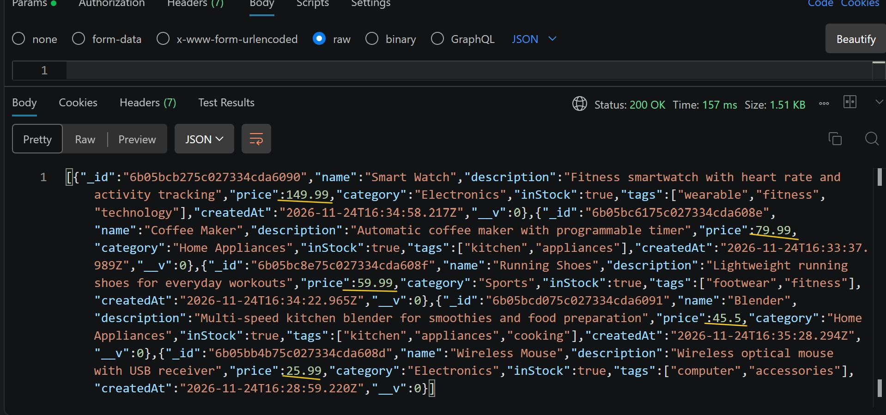

**7f. Pagination using page and limit parameters**

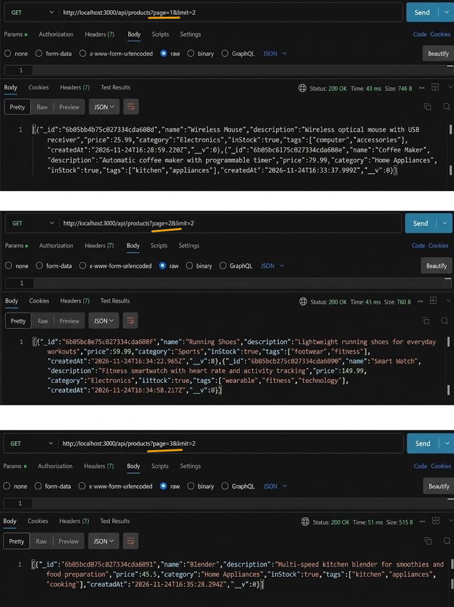

**7g. Combined filtering, sorting, and pagination**

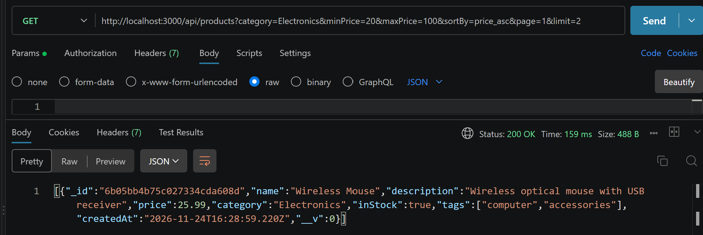

### 8. Error Handling and Validation

**8a. Product not found – 404 response**

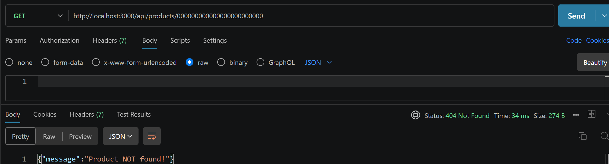

**8b. Invalid product data – 400 response**

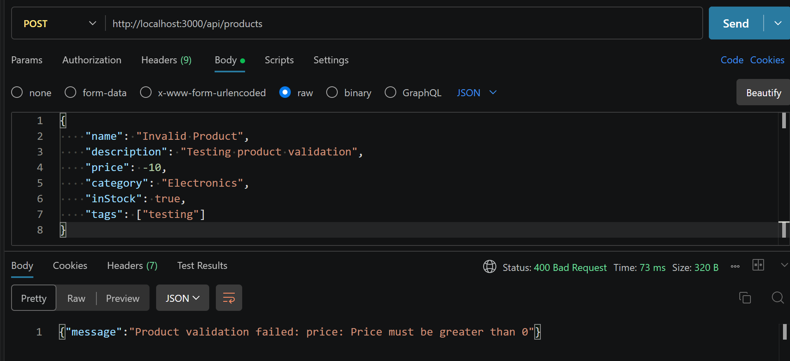

## 11. Challenges Faced and How I Addressed Them

Completing Labs 1 and 2 before starting this SBA was helpful because they gave me a foundation in working with Express routes, MongoDB, Mongoose, and API requests. This prior practice made implementing the Product API easier and helped me understand the overall workflow.

However, I also gained a better understanding of several concepts through hands-on practice during this project.

### 1. Applying Concepts Learned in Previous Labs

Completing the earlier labs helped me become familiar with creating routes, connecting models to database operations, and handling API requests.

This made it easier to approach the SBA because I could build upon concepts I had already practised rather than learning everything from the beginning.

### 2. Understanding Different Sources of Request Data

Although I was introduced to `req.body` and `req.params` in earlier lessons, implementing the different endpoints gave me more clarity through practice.

I also gained a better understanding of `req.query` while implementing filtering, sorting, and pagination.

Working with these different request properties helped me understand where the data comes from and how to access it depending on the API operation.

### 3. Implementing Dynamic Filtering

One challenge was understanding how to build a MongoDB filter dynamically based on the query parameters provided by the client.

I used an empty filter object and added conditions only when the corresponding query parameters were provided.

I also learned how to use MongoDB comparison operators:

- `$gte` to retrieve values greater than or equal to a specified minimum price.
- `$lte` to retrieve values less than or equal to a specified maximum price.

When combining minimum and maximum price conditions, I used the spread operator to preserve existing filter conditions rather than overwrite them.

### 4. Understanding Sorting and Pagination

Implementing sorting and pagination helped me understand how MongoDB retrieves records in a particular order and limits the number of results returned.

I learned that:

- `.sort()` controls the order of retrieved documents. A value of `1` sorts in ascending order, while `-1` sorts in descending order.
- `.skip()` skips a specified number of documents.
- `.limit()` restricts the number of documents returned per page.

I also learned how to calculate the number of documents to skip based on the page number and limit.

### 5. Testing API Operations and Understanding Status Codes

Testing the different API operations using Postman gave me more clarity about how API responses and HTTP status codes work.

By testing successful requests as well as scenarios such as invalid product data and non-existing product IDs, I gained practical experience in understanding the status codes returned by the API.

This helped me understand how the API communicates the outcome of a request to the client.

## 14. Future Improvements

Although the required functionality has been implemented, there are a few enhancements that could be explored in the future:

- Add product search functionality to search by product name or description.
- Add additional filters based on product availability (`inStock`) and tags.
- Improve query parameter validation to handle invalid prices, page numbers, and limits.
- Include pagination metadata in the response, such as the current page, total number of products, and total pages.